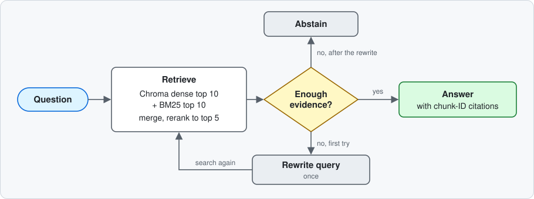
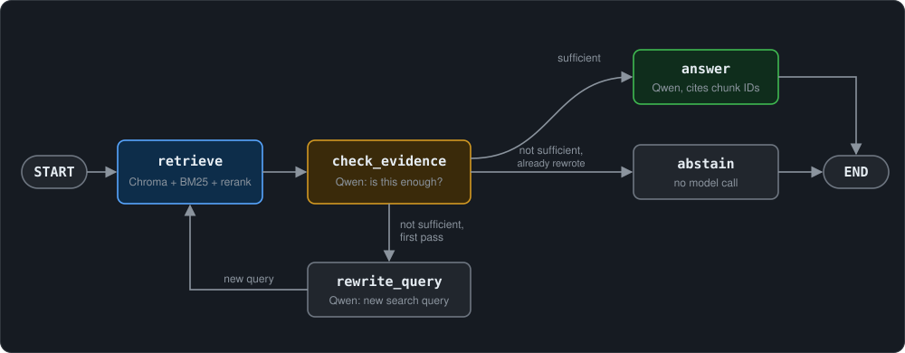

# Lecture RAG

A study assistant over my MATH 235 lecture notes. You ask a question, it finds the right lecture units, and a local LLM answers with chunk-ID citations or says the notes aren't enough.

Every change is scored on labeled questions, with separate dev, held-out, and frozen test sets. On the frozen 40-question test set, reranking puts the right chunk first more often than dense search alone (Recall@1 92.6% vs 80.9%), and with the reranker the plain answer flow answers every answerable dev and held-out question and abstains on every unanswerable one.

| MRR@5 | Dev (28 questions) | Held-out (13) | Test (34) |
| --- | ---: | ---: | ---: |
| Dense | 0.760 | 0.746 | 0.902 |
| Hybrid (dense + BM25 fusion) | 0.656 | 0.708 | 0.764 |
| Dense + BM25 candidates, reranked | 0.982 | 1.000 | 0.971 |

The dev and held-out results guided the reranker choice, so the test column is the clean comparison. I ran it once per setup.

## How it works

Indexing runs once:


Each question goes through this:



1. **Chunks.** One chunk per numbered definition, theorem, example, or exercise from Lectures 1–7. Each chunk gets a one-line lecture prefix and the assumptions I checked for it.
2. **Candidates.** Chroma returns the top 10 by dense search (BGE-small embeddings, cosine similarity). BM25 returns the top 10 by word match. I merge them into up to 20 chunks.
3. **Rerank.** Qwen3-Reranker-8B reads the question with each candidate and scores the pair. The top 5 go on.
4. **Check and answer.** A LangGraph graph asks Qwen whether the five passages are enough. If so, Qwen answers with chunk-ID citations. If not, the graph rewrites the query once and searches again, then abstains if the evidence is still thin.

## What I found

- Dense search beats BM25 on these notes. Weighted hybrid looked best on my 30 dev questions (91.7% Recall@5), but on 16 held-out questions it tied dense at 76.9%. Part of that dev gain came from tuning on the same questions.
- A big LLM reranker fixed most of the ordering problems. Qwen3-Reranker-8B over the merged dense and BM25 top 10s got 0.971 MRR@5 on the 40-question test set, against 0.902 for dense and 0.764 for hybrid. It costs about 1.8 s per question. A smaller reranker (`bge-reranker-base`) was worse than dense on my dev set.
- With the reranker feeding the answer step, the plain baseline answers every answerable question on dev and held-out and still abstains on every unanswerable one. The graph's evidence check adds about 1.5 s per question and no measured gain on top of that.
- Math notation causes most retrieval misses. Questions like "what does `[v]_B` mean" never say "coordinate vector", which is how the notes phrase it.
- With hybrid retrieval, the LangGraph evidence check plus one query rewrite fixed Q13 on the dev set. On the held-out set it fixed one question and broke two, because the checker rejected passages the model could have answered from. With the reranker it breaks nothing.
- Both versions abstained on all five unanswerable questions.

## Quick start

You need Python 3.12, [uv](https://docs.astral.sh/uv/), and [Ollama](https://ollama.com/). I run it on a GX10 with an NVIDIA GB10 GPU. Sentence Transformers picks the device automatically, and `LECTURE_RAG_DEVICE=cpu` overrides it.

```sh
uv sync --locked
# download the embedding model once into the project cache
uv run python -c 'from lecture_rag.dense import EMBEDDING_MODEL, MODEL_CACHE; from sentence_transformers import SentenceTransformer; SentenceTransformer(EMBEDDING_MODEL, cache_folder=str(MODEL_CACHE))'
ollama pull qwen3.6:35b-a3b
# embed the 75 chunks and save them in .cache/chroma
uv run python -m lecture_rag.vector_store --index
uv run python -m lecture_rag.ask "What is a basis?"
```

The first `ask` downloads Qwen3-Reranker-8B, about 16 GB. Ollama needs to be running (`ollama serve`, or the desktop app). `ask` prints the cited answer, the five passage IDs, and the graph's path.

The converted notes are in `lectures/`. The original course PDFs aren't in this repo.

## Experiments

These follow the order I built things in. Each one says which questions and settings it used.

### Retrieval on the dev set


The experiment searches 75 numbered chunks from Lectures 1–7. There are 30 development questions: 28 answerable and two unanswerable.

| Retriever | Recall@1 | Recall@3 | Recall@5 |
| --- | ---: | ---: | ---: |
| Dense | 60.7% | 76.2% | 84.5% |
| Dense, Chroma + LangChain | 60.7% | 76.2% | 84.5% |
| BM25 | 26.8% | 46.4% | 55.4% |
| Hybrid, equal weights | 41.1% | 70.8% | 90.5% |
| Hybrid, 75% dense weight | 44.6% | 70.8% | 91.7% |

I first ran the NumPy dense, BM25, and hybrid comparisons on my Mac, then reran the 75% dense-weight hybrid on the GX10 and got the same numbers. Recall is computed per question, then averaged over the 28 answerable questions.

The Chroma run uses the same BGE model, query instruction, and 75 chunks as NumPy dense search. I reopened the saved index and got the same dev recall at all three cutoffs. Chroma uses a cosine HNSW index for search; LangChain wraps embedding and retrieval. This path uses dense search only. BM25 and weighted fusion are still in the original hybrid path. I didn't compare speed or run Chroma on the held-out or test sets.

Dense ranks the direct answer better near the top. Hybrid finds more labelled evidence within five results, but sometimes pushes related passages above the answer. BM25 lowercases the text and splits on whitespace, so punctuation and math notation can get in the way of matching.

I tuned weights on these same questions, so I also built a held-out set (see below). The gold IDs list the passages I chose as evidence; other passages can also answer a question. Recall measures how much of that labelled evidence search finds. I check generated answers separately.

### Baseline answers


I checked the first 30-answer run against the current chunk texts, using the retrieved IDs:

- The model said it lacked evidence for both unanswerable questions.
- It also couldn't answer Q13. Search missed the definition of `[v]_B` and how reordering a basis changes coordinates.
- Every source ID mentioned in an answer was retrieved, but nine answers used plain IDs rather than the requested bracket citations.
- Q18 added an explanation absent from its evidence. Q29 needed to say that coordinate entries depend on an ordered basis.

The run saved IDs without passage snapshots, so I reviewed against the current corpus. I went through the answers one by one and didn't assign an accuracy score.

### LangGraph flow


`graph.py` runs the same retrieval and generation as a LangGraph graph, with two extra steps:



The checker is a separate Qwen call. It reads the question and the five passages and returns JSON like `{"sufficient": false, "reason": "..."}`. If the evidence isn't enough, the rewriter turns the question into a search query using the checker's reason, and search runs again. After one rewrite the graph abstains instead of looping.

I ran it with the same 30 questions, corpus, model, and settings as the baseline:

| | Baseline | Graph |
| --- | ---: | ---: |
| Answerable questions answered | 27 / 28 | 28 / 28 |
| Unanswerable questions abstained | 2 / 2 | 2 / 2 |
| Recall@5 of the passages sent to the answer step | 91.7% | 95.2% |
| LLM calls for the 30 questions | 30 | 64 |
| Wall time for the 30 questions | 75 s | 124 s |
| Median seconds per question | 2.2 | 3.8 |

Three questions went through a rewrite:

- Q13 was the baseline's miss. The rewritten query put Definition 7.4 (`[v]_B` and basis reordering) at rank 1, and the answer matches that chunk.
- Q09 (eigenvalues) and Q30 (SVD) still had no evidence after the rewrite, so the graph abstained without calling the answer step.

The other 27 questions passed the check on the first try and got the same passages as the baseline.

Limits of this result:

- The gain is one question on the development set, and I built the rewrite step after seeing Q13 fail. The held-out check below shows it doesn't carry over cleanly.
- The evidence check adds about 1.5 s to every question, even the 27 that pass on the first try. The rewrite path adds about 3 s more. Times are from one run each on the GX10 with the model already loaded.
- The checker never rejected usable evidence on these questions. It did on the held-out set (H06).
- The other 27 regenerated answers weren't reviewed line by line, and several still use bare IDs instead of bracket citations.

### Held-out check


After the graph and prompts were fixed, I added 16 new questions in [evaluation/heldout-eval-set.json](evaluation/heldout-eval-set.json): 13 answerable and three unanswerable. Most gold chunks are units that no dev question uses. H15 and H16 ask about kernels and rank-nullity, which are in Lectures 9 and 10 but outside the index. Nothing was tuned on these.

Retrieval on the 13 answerable questions:

| Retriever | Recall@1 | Recall@3 | Recall@5 |
| --- | ---: | ---: | ---: |
| Dense | 65.4% | 73.1% | 76.9% |
| BM25 | 38.5% | 73.1% | 73.1% |
| Hybrid, 75% dense weight | 57.7% | 73.1% | 76.9% |

Hybrid at five drops from 91.7% on the dev set to 76.9% here, and it's no better than dense alone. Part of the dev advantage came from tuning the weight on those questions.

Baseline vs. graph:

| | Baseline | Graph |
| --- | ---: | ---: |
| Answerable questions answered | 12 / 13 | 10 / 13 |
| Unanswerable questions abstained | 3 / 3 | 3 / 3 |
| Recall@5 of the passages sent to the answer step | 76.9% | 80.8% |
| Wall time for the 16 questions | 53 s | 58 s |

The graph helped once and hurt twice:

- H08 asks about `U_n(F)` and `D_n(F)`. The first search missed the upper triangular example (3.8), so the baseline answered half the question and guessed at the rest. The graph's rewrite spelled out "upper triangular" and "diagonal" and found both chunks.
- H06 asks whether `{0}` can be independent. Search missed Example 4.12, but the definition in 4.8 was enough to work it out, and the baseline did. The checker wanted the exact statement, so the graph abstained.
- H12 needs the short subspace test and the line-through-the-origin example. The baseline gave the test and said the example wasn't in its passages. The graph's rewrite still missed the example, so it abstained instead of giving the half it had.
- H10 failed in both. The question writes out the polynomials `{1-x-x^2, 2+3x+4x^2, 5-2x+x^2}`, and neither search found Example 7.10.

On new questions, the strict checker throws away answers the model could have built from related passages. On the dev set that never came up. Retrieval misses (H08, H10, H12) are the bigger problem, and the rewrite only fixes some of them.

### Reranker


Dense search finds the right chunk but doesn't always put it first. A cross-encoder reads the question and one chunk together and scores the pair. Dense search can't do that, because it embeds the question and each chunk separately and compares the vectors.

`rerank.py` takes the top 10 chunks from dense and the top 10 from BM25, merges them without duplicates (up to 20 chunks), scores each one against the question, and keeps the top 5. The reranker reads the same `search_text` as the other retrievers.

I ran four setups on the dev set and checked the two best on the held-out set:

| Dev set | MRR@5 | Recall@1 | Recall@3 | Recall@5 |
| --- | ---: | ---: | ---: | ---: |
| Dense | 0.760 | 60.7% | 76.2% | 84.5% |
| `bge-reranker-base` | 0.671 | 49.4% | 70.2% | 82.7% |
| `bge-reranker-base`, body only (no header) | 0.515 | 35.7% | 55.9% | 59.5% |
| `bge-reranker-v2-m3` | 0.738 | 56.5% | 84.5% | 85.7% |
| `Qwen3-Reranker-8B` + instruction | 0.982 | 88.7% | 98.8% | 100% |

- `bge-reranker-base` was worse than dense. When it pushed a gold chunk down, it usually picked a short chunk that reused the question's words over the one that answered it. For "what degree is the zero polynomial", it ranked Exercise 3.10, which only mentions "zero polynomial" and "degree", above Definition 2.1, which says `deg(0) = -∞`.
- Scoring only the chunk body, without the lecture prefix and assumptions, dropped MRR from 0.671 to 0.515. The header carries a lot of the signal.
- Qwen3-Reranker-8B is an LLM that reads a task instruction along with the pair. I wrote one instruction before running it and didn't change it: "Given a question from a student studying linear algebra, find the passage from the lecture notes that answers it. Passages are definitions, theorems, examples, or exercises. Prefer the passage that actually states the answer over one that only mentions the same terms." I didn't run the 8B model without the instruction, so the table doesn't separate the instruction's effect from the model size.

I picked the model using the dev and held-out results, so the test set is the clean comparison. On held-out, `bge-reranker-v2-m3` got 0.788 MRR@5 and Qwen3-Reranker-8B got 1.000.

### Test set


The held-out set is used up now that I've looked at its per-question results, so I froze a third set in [evaluation/test-eval-set.json](evaluation/test-eval-set.json): 40 questions, 34 answerable and six unanswerable. The gold chunks cover most units that neither earlier set uses. Three unanswerable questions (linear transformation matrices, isomorphisms, change-of-basis matrices) are close to topics the notes do cover, which makes abstaining harder.

I ran dense, hybrid, and the Qwen3-Reranker-8B setup on it once each, with nothing changed after the dev and held-out runs:

| Test set, 34 answerable | MRR@5 | Recall@1 | Recall@3 | Recall@5 |
| --- | ---: | ---: | ---: | ---: |
| Dense | 0.902 | 80.9% | 94.1% | 95.6% |
| Hybrid, 75% dense weight | 0.764 | 67.6% | 73.5% | 89.7% |
| Dense + BM25 candidates, `Qwen3-Reranker-8B` | 0.971 | 92.6% | 97.1% | 97.1% |

MRR@5 across all three sets:

| | Dev | Held-out | Test |
| --- | ---: | ---: | ---: |
| Dense | 0.760 | 0.746 | 0.902 |
| Hybrid, 75% dense weight | 0.656 | 0.708 | 0.764 |
| Reranked | 0.982 | 1.000 | 0.971 |

- The reranker is best on every metric, but the margin depends on how hard the set is. Dense is much stronger on the test set than on dev, so the MRR gain shrinks from +0.22 to +0.07. Most of it is at rank 1 (Recall@1 up about 12 points). Recall@5 is up by one gold chunk.
- Hybrid has lower MRR than dense on all three sets. Fusing in BM25 helps recall but puts related chunks above the answer.
- The reranked Recall@3 and Recall@5 are both 97.1%, because one of the 37 gold chunks isn't in the 20 candidates, and a reranker can't recover a chunk it never sees.
- Reranking takes about 1.8 s per question with the 8B model. `bge-reranker-v2-m3` takes about 0.3 s and `bge-reranker-base` about 0.1 s.
- The test set hasn't gone through the answer step, and answer correctness isn't scored yet.

### Answers with the reranker


I ran the baseline (`rag.py`) and the graph (`graph.py`) with both retrievers on the dev and held-out questions. I didn't run the test set. "Answered" means the model didn't abstain. Answer correctness isn't scored here.

| | Dev answered | Dev abstained | Held-out answered | Held-out abstained | Median s/question (dev) |
| --- | ---: | ---: | ---: | ---: | ---: |
| Baseline, hybrid | 27 / 28 | 2 / 2 | 12 / 13 | 3 / 3 | 2.6 |
| Baseline, rerank | 28 / 28 | 2 / 2 | 13 / 13 | 3 / 3 | 4.6 |
| Graph, hybrid | 28 / 28 | 2 / 2 | 10 / 13 | 3 / 3 | 3.6 |
| Graph, rerank | 28 / 28 | 2 / 2 | 13 / 13 | 3 / 3 | 6.1 |

- The reranker fixes the baseline's two misses (Q13 and H10). Every answerable question has its gold chunk in the passages sent to the model (Recall@5 of 1.000 on both sets).
- With the reranker, the graph answers exactly the same questions as the baseline, about 1.5 s slower per question. The checker only sends a question to the rewrite step for the unanswerable ones (Q09, Q30, H14, H15, H16), and the baseline already abstains on those because the prompt tells it to.
- With hybrid retrieval, the rewrite did fix Q13 and H08. The reranker fixes both without it. The checker also broke H06 and H12 under hybrid, and with the reranker it doesn't.
- There are only 2 and 3 unanswerable questions in these sets, so abstention is checked on a small sample.

I'm leaving the graph as it is. The tables above show how the evidence check behaves with a weak retriever and with a strong one.

## Reproduce the measurements

```sh
uv run python -m lecture_rag.prepare
uv run pytest -q
uv run ruff check .
```

`prepare` loads the corpus and checks that every gold ID exists. These commands print Recall@1, @3, and @5, plus MRR@5:

```sh
uv run python -m lecture_rag.dense
uv run python -m lecture_rag.sparse
uv run python -m lecture_rag.hybrid
uv run python -m lecture_rag.rerank
```

Dense, hybrid, and the reranker take `--dataset`, so `--dataset evaluation/heldout-eval-set.json` runs the held-out questions and `evaluation/test-eval-set.json` runs the test set. Hybrid fuses ten candidates from each retriever with a dense weight of 0.75 and RRF constant of 60. `rerank` also prints the average rerank time per question; change `RERANK_MODEL` in `rerank.py` to try a different model. These scripts rebuild embeddings and BM25 once per run.

The Chroma index:

```sh
uv run python -m lecture_rag.vector_store --index
uv run python -m lecture_rag.vector_store --evaluate
uv run python -m lecture_rag.vector_store --ask "What is a basis?"
```

`--index` embeds the chunks and saves their vectors, search text, stable IDs, and source metadata in `.cache/chroma`. Running it again re-embeds and updates records with the same IDs. `--evaluate` reopens the index and prints Recall@1/3/5 on the dev questions; it also accepts `--dataset`. `--ask` embeds the question, retrieves five chunk IDs through LangChain, fetches their saved text from Chroma, and passes them to the same Qwen answer function as `rag.py`. Evaluation and asking embed questions only. Re-index if the chunk text changes. If chunks are removed or the embedding model changes, rebuild the local store, because the script doesn't clean up old records.

The answer runs:

```sh
uv run python -m lecture_rag.rag --retriever hybrid --output artifacts/baseline-answers.json
uv run python -m lecture_rag.graph --retriever hybrid --output artifacts/graph-answers.json
```

`rag.py` answers every question in a set and saves JSON with the answers, the full retrieved passages, and the settings. The prompt asks for evidence-only answers and citations. `graph.py` also saves the checker's decision and reason and the final passages. Both take `--dataset` and `--output`, and `--retriever hybrid` (dense + BM25 fusion, what the older answer tables used) or `--retriever rerank` (Chroma + BM25 + the reranker, the default). Set `OLLAMA_URL` to override the default `http://127.0.0.1:11434/api/chat` endpoint. The checker and rewriter call Ollama through `langchain-ollama`'s `ChatOllama`, which still uses its default local host.

Generation uses `think=False`, `stream=False`, temperature 0, and `num_batch=2048`. Ollama crashed on longer prompts on this GB10; changing the batch size made the same request pass twice after fresh model loads. A [similar upstream report](https://github.com/ollama/ollama/issues/17434) describes the failure.

## Code and data


```text
src/lecture_rag/   Python package: parsing, retrieval, evaluation, generation
tests/            Unit and integration checks
evaluation/       Questions, gold labels, and source verification
lectures/         Converted notes
```

- `src/lecture_rag/chunk.py` / `prepare.py`: split numbered lecture units, attach source metadata and checked assumptions, check that gold IDs exist in the corpus.
- `dense.py` / `sparse.py` / `hybrid.py`: NumPy cosine ranking, BM25, and weighted reciprocal rank fusion.
- `metrics.py`: Recall@k and MRR, shared by the retrievers.
- `rerank.py`: merge dense and BM25 candidates, score them with a cross-encoder, and evaluate the reranked top 5.
- `pipeline.py`: loads the Chroma store, BM25, chunks, and reranker once, then returns the reranked top 5 passages for a question.
- `ask.py`: one question through the pipeline and the graph.
- `vector_store.py`: persistent Chroma indexing, LangChain dense retrieval, retrieval evaluation, and single-question answers from saved passages.
- `rag.py`: collect evidence, build the prompt, call Ollama, and export answers.
- `graph.py`: LangGraph state, nodes, and routing for retrieve, check evidence, rewrite once, answer, or abstain.

The tests check the metric functions, corpus loading, and that every gold ID exists in the corpus. Answer quality needs its own review. The converted corpus has 11 lectures and three practice files; the experiment indexes Lectures 1–7.

Each chunk keeps its original body and a `search_text` containing the lecture prefix, reviewed assumptions, and body. Lecture intros, trailing Source checks, practice files, and eval material stay out of the index. Source corrections and unresolved issues are recorded in each lecture's Source checks section.

## Next


Score answer quality by hand on a sample (is the answer right, do the citations support it). Then wrap the pipeline in a small API.
